# Whiteout Buff Scheduler v4 walkthrough

Use the v4 browser planner to read a survey, preserve accepted appointments, review the policy and export a planning workbook. This guide follows five synthetic members from the supplied files. It does not book appointments in the game.

[Illustrated website guide](https://christianjoudon.github.io/whiteout-buff-scheduler/walkthrough.html) · [Project case study](https://christianjoudon.github.io/whiteout-buff-scheduler/) · [Launch the planner](https://christianjoudon.github.io/whiteout-buff-scheduler/Whiteout%20Buff%20Scheduler.html)

Edition: 26 October 2026. Synthetic examples only. This page replaces the earlier inventory based explanation at the same address. Version 4 uses declared incremental benefit and explicit access policies.

## Contents

* [What will I make, and what do I need?](#start)
* [Which rules should I set before importing?](#options)
* [How do I load the response file?](#import)
* [How do I preserve an appointment already accepted?](#accepted)
* [What do the result cards actually count?](#results)
* [Why is benefit ranking disabled for this sample?](#fallback)
* [What must I do with the comments?](#review)
* [How should I inspect the three days?](#days)
* [Which sheets should I download and share?](#download)
* [When does this become a game appointment?](#game)
* [What does a benefit estimate mean?](#benefit)
* [How can I compare access with measured benefit?](#policies)
* [How do I correct a blocked or ambiguous input?](#reference)
* [When do I need the advanced plan optimizer?](#advanced)
* [How do I calculate a supplied task comparison?](#mechanics)
* [Which edition and evidence does this guide use?](#edition)

## What will I make, and what do I need?

This route is for the organizer preparing Construction, Research and Troop Training appointments from a response file. You do not need Python for the browser workflow.

### Keep the result in scope

Whiteout Survival gives temporary office titles that can help particular actions. This planner assigns requested appointments across the form's three buff days. It treats a seat as occupied for 30 minutes and produces a draft for review. A result in the browser, including a reviewed result, is not a reservation in the game's appointment interface.

### Use the supplied example

Download sample-survey.csv and sample-accepted.csv. The survey contains Aster, Birch, Cedar, Dawn and Elm, with five distinct Player IDs and ten requested member and day combinations. Elm's Research benefit is deliberately unknown. The accepted file contains Preserved member, ID 999999, who is absent from the survey. These names, times and estimates are invented teaching data.

### Follow one complete route

Set Options before choosing the survey. Then import the optional accepted appointments, review the result and comments, inspect the days, and download the workbook. Keep the original files available for corrections. The page initially loads fonts and its spreadsheet library over the network; it processes the selected survey locally.

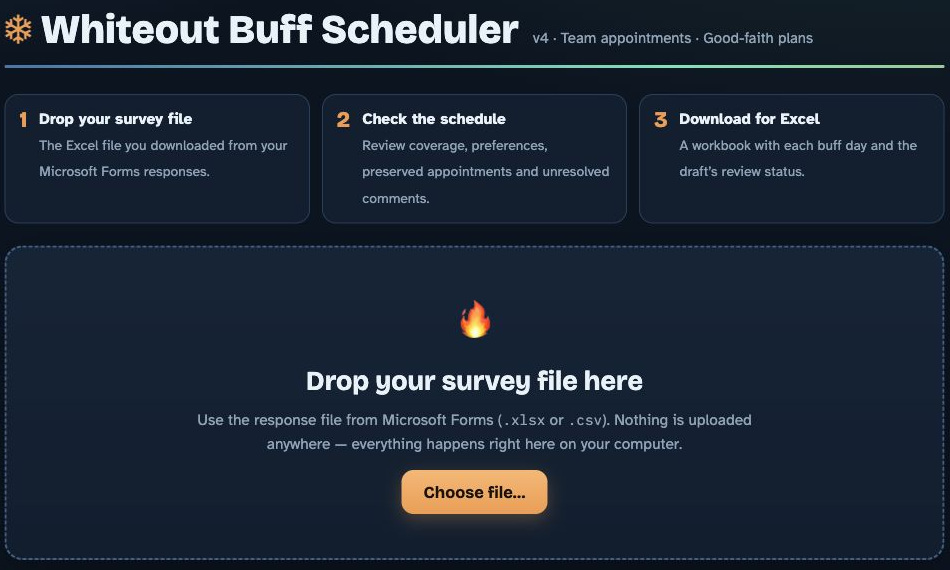

Figure 1. The opening view introduces import, review and export, with the survey drop area ready for a file.

[Download the synthetic survey](https://christianjoudon.github.io/whiteout-buff-scheduler/sample-survey.csv)
[Download the synthetic accepted appointments](https://christianjoudon.github.io/whiteout-buff-scheduler/sample-accepted.csv)
[Open the browser planner](https://christianjoudon.github.io/whiteout-buff-scheduler/Whiteout%20Buff%20Scheduler.html)

## Which rules should I set before importing?

Open Options and establish the event rules before the file starts an automatic calculation.

### Keep the example settings consistent

For this walkthrough, keep Appointments per player for the whole event at Up to one on each buff day (recommended). Keep Team policy at Broad first access, then measured extra benefit. Set Schedule day runs from to 08:00 and …until (UTC) to 10:00. This is the sample window, not a recommended window for every event. In actual work, use the times agreed for that event.

### Understand the fixed seat length

Office occupancy offers 30 minutes (minimum seat rotation). This edition does not offer shorter appointments. A whole seat must fit both the selected window and the member's available time. An action that finishes quickly does not free the remainder of its seat in this model.

### Set preferences and export names deliberately

Leave Honor structured preferred UTC windows in the selected policy order enabled for the example. Those windows are preferences, while availability and unavailable windows are hard limits. The names option affects shared day sheets and Summary; it does not remove names from private notes. Changing an option after loading a survey recalculates that file and resets comment review, so review the new result before exporting again.

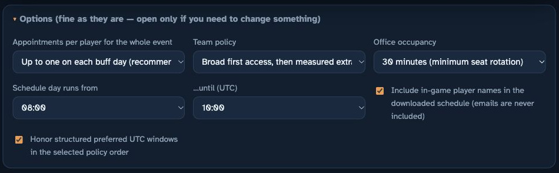

Figure 2. The example uses the default access policy, a 30 minute seat and an 08:00 to 10:00 UTC window.

## How do I load the response file?

Selecting the file starts scheduling. There is no separate Generate button.

### Choose the survey

Select Choose file… and open sample-survey.csv, or drag that file into the survey drop area. Use the survey control rather than the separate accepted appointments control. A real Forms export can be .xlsx or .csv; the chooser also accepts .xlsm. Keep recognizable headers and the original response rows.

### Wait for the saved result on screen

Continue when the Done status and result cards appear. The file's five rows identify five survey members. Inventory columns are optional in v4, and this example has none. A member with no declared speedups can still receive an appointment. Do not add stock figures merely to make a member eligible.

### If loading stops

Read the specific error instead of substituting another file. A missing Player ID or availability column needs a correct header or export. If the spreadsheet reader failed to load, reload with a network connection and choose the file again. Reloading clears the current browser selection. Keep any genuine accepted appointments available to reimport before using a replacement plan.

Figure 3. Choose the survey response file in the main drop area. Selecting it starts the calculation.

## How do I preserve an appointment already accepted?

Import commitments before assessing the new draft. A commitment is a fixed constraint, not a preference.

### Load the accepted file

Under Keep accepted appointments, use Existing appointments CSV to choose sample-accepted.csv. The file supplies Day, Start UTC and Player ID, with optional Alliance and Player Name. Day must be construction, research or training; the start must be a valid half hour time in HH:MM form. This example preserves construction at 08:30 for ID 999999, alliance GUEST.

### Check the preserved row

The import recalculates the survey. On Construction Day, find Preserved member at 08:30 and the accepted · fixed label. The member is kept even though no survey row exists for that ID. This appointment occupies its seat. It contributes to the appointment total and day sheet, but not the survey coverage denominator, measured benefit or survey Summary rows.

### Resolve a conflict explicitly

If two accepted rows claim the same seat, or a known member's commitment contradicts current availability, the planner stops with a concrete error. It does not move the commitment. Check the agreed record and correct the conflict. Clear imported appointments removes the imported constraints, so use it only when the import itself should be removed, not as a way around a genuine commitment. If an error appears, do not treat an earlier visible result as a successful new calculation.

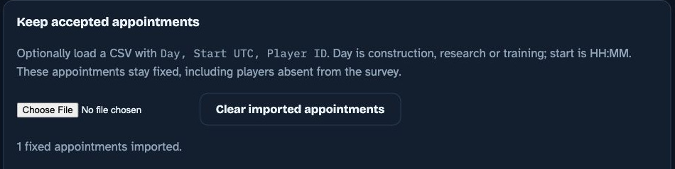

Figure 4. The separate accepted appointments control imports commitments after the survey has been selected.

Figure 5. An external accepted member remains fixed at 08:30 on Construction Day.

Figure 6. A separate synthetic conflict demonstrates a blocker. It is not an alteration to the original sample.

## What do the result cards actually count?

Read the coverage, appointment count, measured subtotal and source response count as different quantities.

### Separate members from appointments

Players placed shows covered survey members out of the five unique survey members. Appointments made counts assignments, including the preserved external appointment. One member can appear on several requested days, so these cards need not match. The Done sentence can also include the external member, while the coverage card remains survey based.

### Read the subtotal as a subtotal

Measured subtotal · minutes saved adds supplied benefit estimates for scheduled survey requests that have an estimate. It is additional timer time saved against the same plan without the title. It is not inventory, total work completed, preparation points or a complete gain total when estimates are missing. A visible number can coexist with benefit ranking being disabled.

### Read the explanation below the cards

Model and review status lists the objective order, requested days covered, structured preferences honored and accepted appointments preserved. Check that explanation before interpreting the schedule. Survey responses read counts the file rows; duplicate IDs can make that count larger than the unique member total. The supplied sample has no duplicates.

### Read this run without changing its meaning

After the accepted import, the main example covers all five survey members and all ten requested days, with three structured preferences honored. It contains eleven appointments and six distinct assigned IDs because the external commitment is included. The measured subtotal is 595 minutes from known estimates, and five survey responses were read. Elm remains unknown; these counts are synthetic demonstration results, not measured community impact.

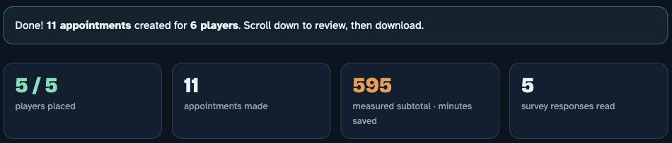

Figure 7. The cards count survey coverage, all assignments, measured benefit and input rows separately.

## Why is benefit ranking disabled for this sample?

Elm's missing Research estimate is intentional. Unknown benefit is not a zero benefit or a reason to exclude Elm.

### Keep the unknown value unknown

Open the original sample and find Elm, ID 100005. Research is requested and an 08:00 to 08:30 window is available, but Research buff benefit minutes is blank. Do not copy another member's value, derive it from speedup stock or enter zero merely to complete the column. Zero would assert a measured absence of additional benefit.

### Follow the safe policy fallback

With incomplete estimates on eligible requests, the default policy disables benefit ranking for everyone. It uses broad access, requested day coverage, structured preferences and complete history instead. Members with estimates do not receive a ranking advantage over members whose benefit is unknown. The status explains this change; the measured subtotal remains only the known portion of the selected plan.

### Do not force the benefit policy

Selecting Measured extra benefit first (requires complete estimates) with an eligible estimate missing produces an error identifying the request. Supply a defensible estimate or return to broad team access. Missing history follows a separate rule: if any survey member's history is unknown, rotation ranking is disabled for all. The original sample has explicit history values for all five members.

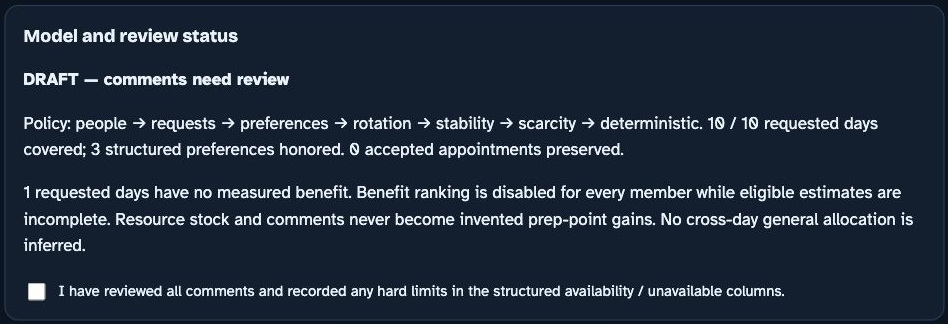

Figure 8. The original sample keeps Elm's benefit unknown and disables comparative benefit ranking for every member.

## What must I do with the comments?

Read comments as source information. The solver does not convert free text into wishes or prove task readiness.

### Review the two supplied comments

Aster asks for Research after a lab prerequisite and requests a readiness check before booking. Elm says there are no speedups and a long research will be started. These comments explain context, but neither supplies a verified extra time window or a calculated title benefit. Do not invent either from the wording. Check readiness with the member before carrying the plan into the game.

### Record confirmed time restrictions structurally

If follow up establishes a hard time limit, put it in the applicable availability or unavailable column and reload the corrected file. Put a preferred time in the matching preferred UTC column. Review Needs a quick look from you separately from What people wrote in the comments. An input problem is not resolved simply because a comment was read.

### Acknowledge review without upgrading the result

When the statement is true, select I have reviewed all comments and recorded any hard limits in the structured availability / unavailable columns. The status can then become Planning draft — reviewed inputs. That acknowledgment does not validate a prerequisite, buy a title or make a game booking. DRAFT — input issues need resolution remains when structured input issues exist, even if the checkbox is selected. Any recalculation resets comment review.

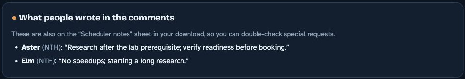

Figure 9. The supplied comments remain visible for organizer judgment rather than becoming automatic scheduling wishes.

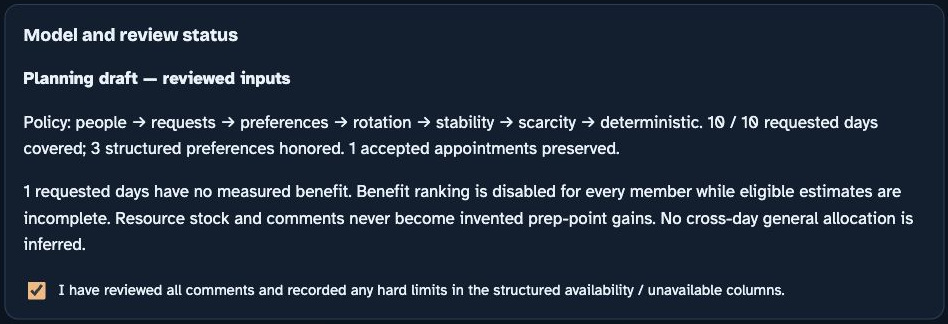

Figure 10. A reviewed input state records the organizer's acknowledgment. It remains a planning draft.

## How should I inspect the three days?

Read the actual rows after the imports and review. Do not infer a game calendar from a weekday label.

### Inspect each tab

Open Construction Day (Monday), Research Day (Tuesday) and Troop Training Day (Thursday) in turn for this sample. These are the default labels when the form provides no other recognized weekday. They are not dated event reservations. All displayed times are UTC. Use the actual event dates when organizing the final game actions.

### Connect a row to its source

Aster's Construction unavailable window is 08:00 to 08:15. Because that overlaps the first 30 minute seat, the entire 08:00 Construction appointment is unavailable to Aster. Birch can use only the 08:00 Construction seat. Cedar has a structured Research preference for 08:30 to 09:00, while Dawn has a Training preference for 09:00 to 10:00. Preferences can lose to higher policy priorities; a hard exclusion cannot.

### Keep manual edits outside the solver's guarantee

An open row means no assignment was selected there. Empty seats are allowed. If the event window or cap changes, change Options and review the recalculated result. A manual workbook swap is not automatically checked by the browser. Preserve the accepted external member unless the real commitment has been changed explicitly.

| UTC start | Construction | Research | Training |
| --- | --- | --- | --- |
| 08:00 | Birch | Elm | Cedar |
| 08:30 | Preserved member, fixed | Cedar | Aster |
| 09:00 | Aster | Aster | Dawn |
| 09:30 | Dawn | Dawn | Open |

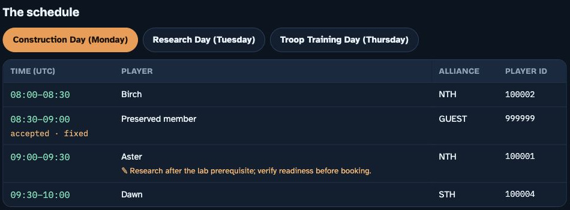

Figure 11. Construction preserves the external 08:30 commitment and respects Aster’s overlapping exclusion.

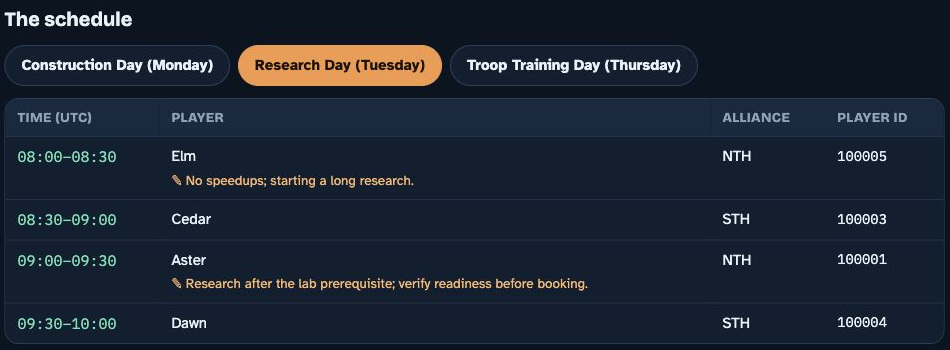

Figure 12. Research rows can be checked against requested days, full availability and structured preferences.

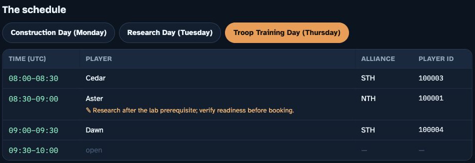

Figure 13. Training uses the same appointment rules but its own requested days and preferred windows.

## Which sheets should I download and share?

Download only the version corresponding to the final options and imports you reviewed. Export is possible even while the plan is marked DRAFT.

### Open the workbook

Select Download the schedule (.xlsx) and open the saved file in Excel or Google Sheets. This edition exports six sheets: three buff day sheets, Summary, Declared resources and Scheduler notes. An unresolved draft has DRAFT in its filename. Download availability does not mean the organizer's review is finished.

### Use the appropriate sheet

Day sheets list time, Player ID, alliance and optional name, including imported external commitments. Summary describes the survey members' assignments and measured extra minutes. Declared resources preserves recognized resource answers as context, not inferred title gains. Because the supplied sample has no inventory columns, that sheet can contain its headers without resource records. Scheduler notes records review status, policy, issues, unplaced reasons and source comments.

### Review privacy before sharing

Turning names off changes day sheets and Summary. It does not anonymize Scheduler notes, the on screen comments or every identity field. IDs and alliances remain identifiers, and free text may contain personal information or an email address even though no dedicated email column is exported. Keep private notes for the organizer and share only the intended sheets after inspecting their contents.

| Sheet | Use |
| --- | --- |
| Construction Day (Monday) | Construction appointments, including fixed imports |
| Research Day (Tuesday) | Research appointments |
| Troop Training Day (Thursday) | Training appointments |
| Summary | Survey members and measured assigned benefit |
| Declared resources | Original recognized inventory answers for context |
| Scheduler notes | Private review status, issues and comments |

Figure 14. Select Download the schedule (.xlsx) to save the current draft. This synthetic run’s saved workbook was reopened and all six sheets were inspected.

The browser does not reopen the downloaded file for verification. Opening and inspecting it is part of this organizer review.

## When does this become a game appointment?

The documentation route ends with a reviewed plan. Booking in the game is a separate action.

### Confirm the live conditions

Before arranging real appointments, confirm current event dates, office rules, member readiness and the actual accepted schedule. The app models a 30 minute seat even if an action finishes early. A title relevant to a new start must be obtained before that action begins; a planning row does not establish that this happened.

### Keep a clear completion boundary

The walkthrough is complete when the applicable imports and issues have been reviewed and the intended workbook has been inspected. A reviewed draft can still need a prerequisite check or game booking. Record that remaining work as pending rather than calling the downloaded schedule a confirmed reservation.

## What does a benefit estimate mean?

Compare the same declared plan with and without the requested title. Inventory and gross event contribution answer different questions.

### Use one counterfactual

Construction buff benefit minutes means additional whole minutes saved by the title over the same work without it. Research and Training use their equivalent headers. The comparison must keep its baseline clear. A member can contribute without an appointment, so the no title baseline is not automatically zero work or zero contribution.

### Do not multiply shared resources

Browser estimates must already account for any allocation of general speedups across days. The browser does not distribute that pool, simulate spending or derive gains from stock. It accepts nonnegative whole minute estimates for individual requests. If tasks or resources interact, use complete alternatives in the advanced route rather than adding incompatible day estimates.

### Distinguish a known zero from a blank

Enter zero only when the comparison supports no additional timer saving. Leave an unknown estimate blank and accept the disclosed fallback. The separate mechanics calculator can evaluate supplied task statistics, but its output is conditional on those inputs; it is not a browser control or a live game forecast.

| Quantity | What it describes |
| --- | --- |
| Inventory | Resources owned or declared for use |
| No title baseline | What the same plan contributes without the requested title |
| Incremental benefit | The additional result compared with that baseline |
| Browser benefit minutes | Supplied nonnegative whole minutes of additional saving |
| Game event points | A separate quantity requiring the applicable scoring conditions |

## How can I compare access with measured benefit?

Use examples/comparison-survey.csv for this separate comparison. It changes only Elm’s Research benefit to a synthetic 25 minutes; the original sample remains unchanged.

### Use the complete estimate variation

Load examples/comparison-survey.csv, keep the same accepted appointment, and narrow the window to 08:00 to 09:00 UTC. Keep the event cap at three and the default broad first access policy. These are deliberate variation settings, not the main walkthrough settings. All eligible benefits are now supplied. The 25 minute value is a teaching assumption, not a calculation of a real member’s benefit or permission to fill a production blank arbitrarily.

### Read both measured outcomes

For this variation, broad first access serves five survey members for 300 measured extra minutes. Benefit first serves three for 410 minutes. The broad policy shows six appointments including the external commitment, five of ten requested days covered and no preferred windows honored. Select Measured extra benefit first (requires complete estimates) to inspect its alternative. The comparison exposes a real model tradeoff: two fewer survey members receive access in return for 110 more declared minutes, under these synthetic inputs.

### Choose the policy openly

Broad access, then requested days and preferences puts request coverage, preferences and complete history ahead of benefit. All policies keep hard constraints and accepted commitments. A lower priority can break a tie but cannot silently outweigh a higher one. Changing the policy recalculates the file and requires a fresh review before the replacement download.

Figure 15. The separately labeled complete estimate variation exposes access and measured benefit side by side. Values belong only to that synthetic variation.

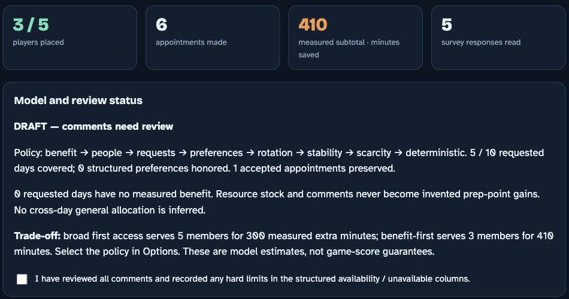

Figure 16. Switching to benefit first in the same complete variation serves three survey members for 410 declared extra minutes, while the broad access comparison remains visible.

[Download the separately labeled complete estimate variation](https://christianjoudon.github.io/whiteout-buff-scheduler/examples/comparison-survey.csv)

## How do I correct a blocked or ambiguous input?

Use the reported symptom to find the source field. Do not alter a genuine constraint merely to obtain a schedule.

### Ambiguous time or no full seat

Replace local time abbreviations and phrases such as only after with confirmed positive UTC ranges. Write 20:00 to 22:00 rather than 8 to 10pm, or put AM or PM on both endpoints. Equal endpoints are ambiguous; use All day if that is what the member meant. A ten minute window cannot contain a 30 minute seat. An unavailable interval that overlaps any part of a seat removes that seat.

### Wrong or missing benefit and history

Benefit entries must be nonnegative whole minutes. History must be a nonnegative whole appointment count. Do not turn malformed values into zero. Unknown benefit and unknown history disable their respective ranking layers globally, rather than penalizing the affected person. With no selected day column, v4 derives requested days from available day windows; with the column present, explicit choices govern, so a blank choice is not all days.

### Duplicate or conflicting records

Use one Player ID for one member. A recognized completion timestamp takes precedence for duplicate submissions; the latest recognized time wins, with the later row winning a tie or when both timestamps are absent. Review the retained answers. For accepted appointments, resolve a duplicate seat, conflicting member and day, event cap conflict or out of window start against the actual commitment before rescheduling.

| Exact example header | Meaning |
| --- | --- |
| Player ID | Identity used to retain one survey record per member |
| Desired buffs | Requested construction, research or training days |
| General availability | Positive UTC windows shared across days |
| Construction preferred UTC | A preference within policy priorities |
| Construction unavailable UTC | An exclusion that removes overlapping seats |
| Construction buff benefit minutes | Additional whole minutes saved; blank means unknown |
| Prior appointments | Known prior access count; blank means unknown |
| Comments | Source text for organizer review, not automatic wishes |

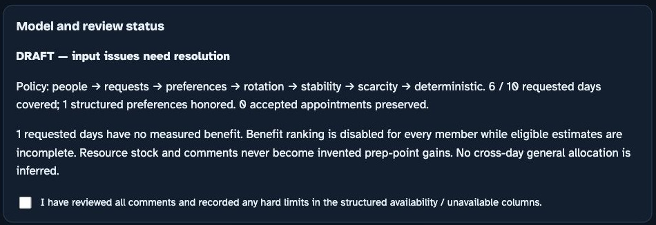

Figure 17. A separately labeled malformed time variation illustrates input recovery without changing the original sample.

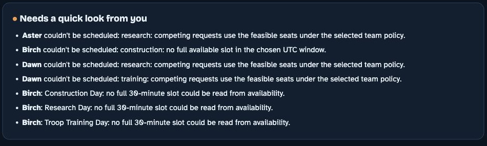

Figure 18. The separate malformed time variation reports why Birch has no full available seat. Correct the source availability rather than clearing a genuine limit.

Figure 19. The explicit benefit first policy rejects an eligible unknown estimate instead of treating it as zero.

Research and Training use the corresponding preferred UTC, unavailable UTC and buff benefit minutes headers. Inventory columns remain optional.

## When do I need the advanced plan optimizer?

Use this separate Python route for coupled tasks, shared budgets, absolute dates or multiple physical offices. A browser survey is not its input file.

### Prepare the separate Python route

Use a terminal from the v4 package folder on macOS or Linux with Python 3 available. Read advanced/schema.txt and keep the supplied advanced/example.json unchanged for the first run. Create a dedicated environment before installing requirements.txt into it, then run the synthetic example with that environment’s Python. The production engine is OR-Tools CP-SAT; the program does not install dependencies itself.

### Describe complete alternatives

Supply exactly one baseline plan per member, plus mutually exclusive complete event alternatives. Benefits are signed integer differences in one declared objective unit, not browser benefit minutes inferred from stock. Declare resource consumption once for each complete plan, the member's budgets, requested days, physical offices, absolute UTC intervals, prerequisites and commitments. The baseline has no appointments and zero incremental benefit, but may still consume resources or do useful work.

### Interpret the result status

OPTIMAL requires proof at all six policy stages. FEASIBLE means an incumbent exists but a stage is unproved; UNKNOWN means no complete incumbent was found by the deadline. INPUT_ERROR, INFEASIBLE and DEPENDENCY_MISSING require their stated resolution. Do not publish them as a completed optimized plan. The exhaustive engine is a bounded reference for small inputs, not an automatic production fallback. Declared plans still need game feasibility outside the optimizer.

| Step | Command | Expected result |
| --- | --- | --- |
| Create the environment | python3 -m venv .venv | A dedicated local Python environment |
| Install the declared dependency | .venv/bin/python -m pip install -r requirements.txt | OR-Tools available in that environment |
| Run the synthetic plan | .venv/bin/python advanced/optimizer.py --input advanced/example.json --output advanced/result.json | A result file whose status and stages must be read |

[Read the advanced JSON contract](https://christianjoudon.github.io/whiteout-buff-scheduler/advanced/schema.txt)
[Inspect the synthetic advanced input](https://christianjoudon.github.io/whiteout-buff-scheduler/advanced/example.json)
[Inspect the advanced optimizer source](https://christianjoudon.github.io/whiteout-buff-scheduler/advanced/optimizer.py)

## How do I calculate a supplied task comparison?

The mechanics calculator is a separate Python tool. It evaluates explicit statistics and assumptions, not the contents of the browser survey.

### Compare the same work

From the v4 package folder, run the same work command in the table below. This mode compares the same fixed work with and without a title using supplied speed percentages. A fixed time reduction needs an explicit before_speed or after_speed stage. A preexisting queue receives no new title benefit. New start checks use supplied absolute UTC appointments and an exact office identifier; omitted timing context is an assumption, not a verified reservation.

### Keep training quantities separate

The separate fixed budget training example calculates whole troop output from supplied speed, budget and base time, with an optional available unit cap. Promotion needs a supplied source tier and promotion time. Optional event points need explicit scoring inputs. Capacity Enhance changes batch size and batch time; it does not independently multiply per troop throughput.

### Respect the arithmetic boundary

The calculator uses exact fractions for arithmetic and flooring. It does not simulate camp residuals, repeated queue starts, item denominations, collection windows, resource reinvestment or changing buffs at later starts. The integration example requires the advanced environment above and compiles supplied same work calculations into complete alternatives. Its saved result serves two synthetic members for 1,600 additional timer seconds with no general speedups consumed. It is an example result, not a live outcome.

| Route | Command | Output meaning |
| --- | --- | --- |
| Same work | python3 mechanics/task_model.py --input mechanics/sample-same-work.json | Timer saving for supplied identical work |
| Fixed budget training | python3 mechanics/task_model.py --input mechanics/sample-training.json | Bounded troop output for supplied statistics |
| Complete integration | .venv/bin/python examples/from_tasks.py | Task calculations compiled into plans and optimized |

[Read the supplied task calculator instructions](https://christianjoudon.github.io/whiteout-buff-scheduler/mechanics/README.md)
[Inspect the complete integration example](https://christianjoudon.github.io/whiteout-buff-scheduler/examples/from_tasks.py)

## Which edition and evidence does this guide use?

Documentation edition: 26 October 2026. It describes the Whiteout scheduler v4 source files and their supplied synthetic examples.

### Use the current source for current behavior

The browser HTML, README.md, advanced/schema.txt and mechanics/README.md define this edition's separate routes. Older instructions describing stock as title created points, shorter browser seats or automatic free text wishes do not describe v4. Keep the guide and source edition together when sharing a local copy.

### Know what has and has not been established

The saved development verification and the independent release checks dated 26 October 2026 document automated model tests. This documentation also uses an actual synthetic browser import, fixed appointment import and six sheet download that was reopened and inspected. These checks establish the tested behaviors, not novice usability, accessibility conformance, adoption or improved game results. A new reader’s questions and performance require separate observation. Report a mismatch with the source file, setting and visible state so a correction can reach the walkthrough, case study and reference together.

[Read the project case study](https://christianjoudon.github.io/whiteout-buff-scheduler/index.html)
[Read the saved v4 verification record](https://christianjoudon.github.io/whiteout-buff-scheduler/verification.json)
[Read the v4 route overview](https://christianjoudon.github.io/whiteout-buff-scheduler/README.md)
[Read the independent documentation release checks](https://christianjoudon.github.io/whiteout-buff-scheduler/release-checks.json)
